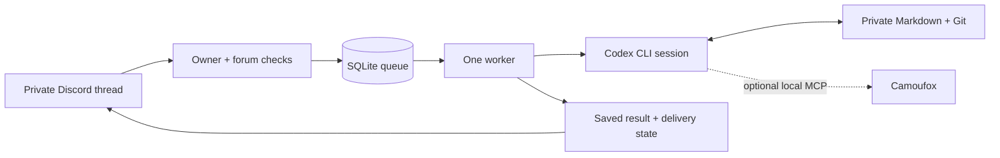

<div align="center">


# szpont-engine

**Send a task from your phone. Pick it up in the same session. Keep the memory.**

A self-hosted personal agent engine connecting private Discord threads to persistent
Codex CLI sessions, a durable SQLite queue, and a private Markdown workspace.

[](https://github.com/dalkedev/szpont-engine/actions/workflows/checks.yml)
[](package.json)
[](LICENSE)
[](https://github.com/dalkedev/szpont-engine/releases)

[Quick start](#quick-start) · [Documentation](docs/index.md) · [Architecture](docs/architecture.md) · [Contributing](CONTRIBUTING.md)

</div>

## Pick up where you left off

Open a private Discord forum thread, send a task, and let your own Linux machine do the work.
Follow-ups resume that thread's stored Codex session. Instructions, notes, and transcripts live
in Markdown you can read, edit, and back up yourself.

When a process times out or the host restarts, the engine keeps the interrupted job visible.
You inspect the saved result and choose when to recover. It never automatically replays an
interrupted job.

## What it does

- **Keeps conversations continuous.** Each Discord thread maps to its own stored Codex session.
- **Records accepted work.** SQLite WAL, unique message IDs, bounded queues, and atomic claims.
- **Makes recovery explicit.** Interrupted and failed turns block that conversation until you act.
- **Explains waiting work.** `!status` shows queue activity, blocked threads, and uncertain result delivery.
- **Checks setup locally.** `npm run doctor` reports configuration and filesystem problems without contacting Discord.
- **Checks deployment identity.** Intake is limited to the configured owner, guild, bot identity, and private forum.
- **Keeps memory readable.** Selected Markdown is committed locally in a separate private Git workspace.
- **Adds browsing when you need it.** An optional Camoufox bridge exposes browser tools over local stdio MCP.

The public edition runs **one global worker** with text-only intake and manual recovery.
It has no message-history catch-up after a full outage, scheduler, or built-in publication broker.
This is a small, inspectable engine for one owner.

## How it fits together



Execution state and notification delivery are recorded separately. A completed local turn does
not prove an external website action succeeded. Read the [architecture](docs/architecture.md)
for state transitions, session handling, and recovery boundaries.

## Quick start

Prefer containers? The [Docker guide](docs/docker.md) provides a non-root image, private volumes,
and an offline sandbox check. [Releases](docs/releases.md) cover version tags and immutable image digests.

You need Linux, **Node.js 24.x**, Git, `flock`, and an authenticated Codex CLI. The process
adapter targets **Codex CLI 0.166.0** and its JSON event format. Configure your own model/account
access; the MIT license covers this source, not inference or third-party services.

### 1. Install and check the engine

```sh
git clone https://github.com/dalkedev/szpont-engine.git
cd szpont-engine
npm --prefix apps/discord-agent ci --ignore-scripts
npm test
```

`npm test` builds the TypeScript engine and runs its offline checks without model calls or
account actions.

### 2. Create your private workspace

```sh
npm run init:workspace -- "$HOME/.local/share/szpont/workspace"
```

The initializer creates a new private Git workspace **outside this checkout** and refuses to
overwrite an existing directory. Edit its `agent/USER.md` and `agent/POLICY.md` before use.

Create your own Discord application and bot, enable Message Content Intent, and choose a
private forum in a server you own. Follow [configuration](docs/configuration.md) for identities,
permissions, paths, and Codex setup.

### 3. Configure and start one instance

```sh
mkdir -p "$HOME/.config/szpont"
cp .env.example "$HOME/.config/szpont/agent.env"
chmod 600 "$HOME/.config/szpont/agent.env"
```

Edit that private file: replace every placeholder and set absolute paths. The engine does not
load `.env` automatically. Load only your own trusted configuration, then start it:

```sh
set -a
. "$HOME/.config/szpont/agent.env"
set +a
mkdir -p "$CODEX_HOME" "$SZPONT_STATE_DIR" "$SZPONT_ARTIFACTS_DIR" "$SZPONT_BROWSER_DIR"
chmod 700 "$CODEX_HOME" "$SZPONT_STATE_DIR" "$SZPONT_ARTIFACTS_DIR" "$SZPONT_BROWSER_DIR"
codex login
npm run doctor -- --check-login
flock -n -E 75 "$SZPONT_STATE_DIR/engine.lock" npm --prefix apps/discord-agent start
```

The lock must be held before startup recovery. Send a harmless task in a new private forum
thread to check your installation. Offline tests do not verify Discord permissions, model
access, or browser login. See [deployment](docs/deployment.md) for unattended hosting and
the [optional browser guide](packages/browser/README.md) for Camoufox setup.

## Use it from Discord

| Input | Effect |
| --- | --- |
| A normal message | Queue a task and continue this thread's session |
| `!help` | Show commands without starting a task |
| `!status` | Show queue activity, authentication, blocked work, and delivery state |
| `!cancel MESSAGE_ID` | Cancel queued work or interrupt a running task in this thread |
| `!recover MESSAGE_ID` | Queue deliberate recovery of a failed or interrupted task |
| `!new-session` | Cancel queued work, keep history, and start a fresh session on the next message |
| `!result MESSAGE_ID` | Read the stored result without rerunning work |

Attachments are rejected. Messages sent during a long outage may never have entered the queue;
use `!status` to inspect what was actually accepted.
Unknown commands and invalid command arguments show usage instead of becoming model tasks.
For setup failures, run the [local doctor](docs/doctor.md); it does not create directories or repair state.

## Keep source public and memory private

```text
szpont-engine/                 # Public source and synthetic templates
~/.config/szpont/agent.env     # Private credentials and deployment IDs
~/.local/share/szpont/
  workspace/                  # Private instructions, notes, transcripts, and Git history
  state/                      # SQLite queue and session mapping
  codex/                      # Private Codex login and configuration
  browser/                    # Optional private browser profile
  artifacts/                  # Private task output
```

The engine commits selected Markdown locally; it does not push memory. Never point the private
workspace's remote at this public repository. Treat transcripts, browser profiles, and generated
artifacts as private data.

## Explore the code

| Path | Responsibility |
| --- | --- |
| [`config.ts`](apps/discord-agent/src/config.ts) | Deployment identity, intake authorization, child environment |
| [`store.ts`](apps/discord-agent/src/store.ts) | Job state, deduplication, sessions, recovery |
| [`engine.ts`](apps/discord-agent/src/engine.ts) | Execution and notification lifecycle |
| [`codex.ts`](apps/discord-agent/src/codex.ts) | Bounded subprocess protocol and cancellation |
| [`workspace.ts`](apps/discord-agent/src/workspace.ts) | Context, transcripts, scoped local memory commits |
| [`packages/browser/`](packages/browser/) | Optional Camoufox MCP tools and offline checks |
| [`examples/workspace/`](examples/workspace/) | Synthetic starting instructions |

## Trust and limits

There is no exactly-once guarantee for external services and no automatic replay of ambiguous
writes. Check the actual destination before recovering work. The configured Codex sandbox,
host permissions, and service account remain part of the trust boundary. Filtering child
environments does not isolate processes sharing a Unix user; browser URL checks do not replace
network isolation. See [security](SECURITY.md) before granting access to real accounts.

[Documentation](docs/index.md) · [Contributing](CONTRIBUTING.md) · [Brand assets](docs/brand.md) · [MIT license](LICENSE)
