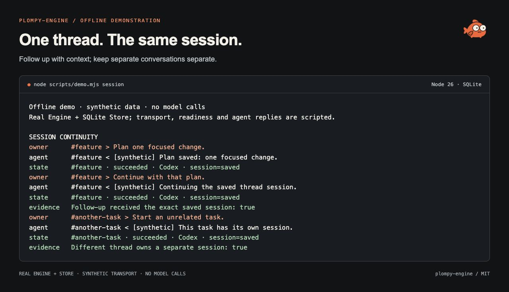
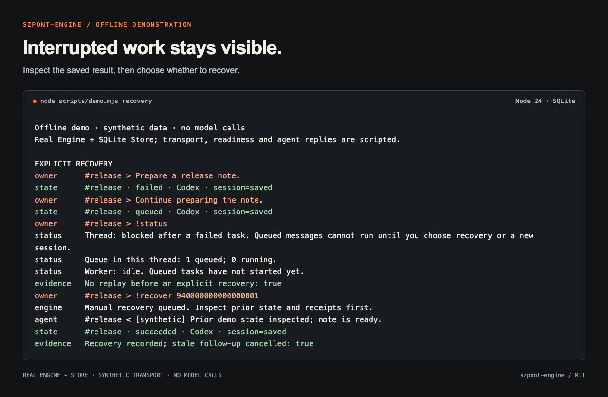
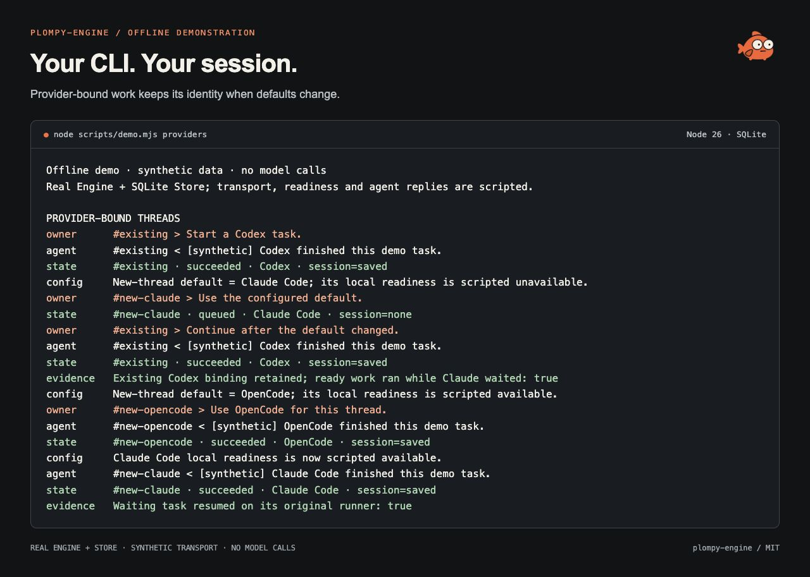
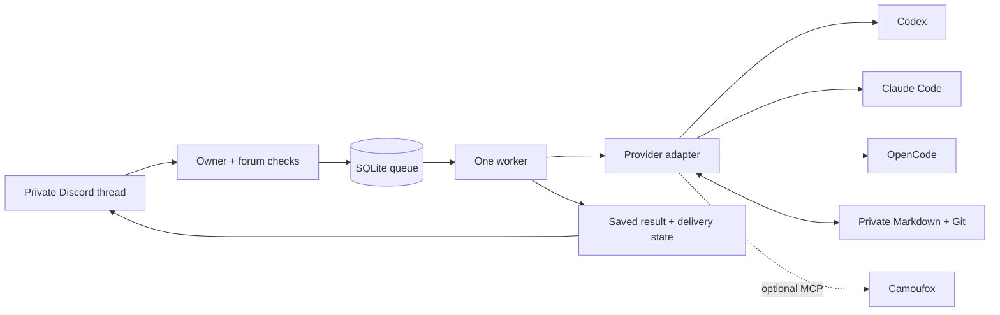

<div align="center">


# szpont-engine

**Run coding agents from private Discord threads.**

One CLI session per thread. A durable queue for accepted work.
Private Markdown context that survives the conversation.

[](https://github.com/dalkedev/szpont-engine/actions/workflows/checks.yml)
[](https://github.com/dalkedev/szpont-engine/releases)
[](package.json)
[](LICENSE)

[Quick start](#quick-start) · [Supervised goals](#from-a-task-to-a-reviewed-change) · [See it work](#see-it-work) · [Runners](#choose-a-runner) · [Documentation](docs/index.md)

</div>

szpont-engine connects a private Discord forum to coding agents on your own Linux machine.
Send a task, follow up in the same thread, and return to a saved result. The engine keeps the
runner session, accepted work and recovery state together, so a disconnected client does not
mean starting the conversation again.

Your phone can go back in your pocket.

## What the engine handles

- **Continuity:** one provider-bound CLI session per Discord thread; private Markdown instructions and notes.
- **Durable intake:** SQLite WAL, deduplicated message IDs, bounded queues and atomic claims.
- **Bounded work:** active execution budgets, typed checkpoints and fair turns between threads.
- **Supervised goals:** a fresh Codex reviewer checks each candidate; an explicit repository binding adds saved code and test diffs.
- **Honest recovery:** interrupted work remains visible; uncertain actions are never replayed automatically.
- **Delivery and maintenance:** result receipts, transcript exports and scoped local Git commits have separate durable state.
- **Deployment checks:** owner/forum authorization, local diagnostics, versioned migrations and verified state snapshots.

The public edition has **one global worker**. Work sessions yield between verified steps;
they do not interrupt a running step. Still-image input and supervised goals use Codex.
There is no built-in scheduler, publication broker or message-history catch-up after an outage.

## Quick start

You need Linux, **Node.js 26.13.0+ (26.x LTS)**, Git, `flock`, your own Discord bot and an authenticated runner.
The default path below uses Codex CLI **0.166.0**.
For containers, start with the [Docker guide](docs/docker.md).

### 1. Install and try the offline demo

```sh
git clone --branch v0.10.0 --depth 1 https://github.com/dalkedev/szpont-engine.git
cd szpont-engine
npm --prefix apps/discord-agent ci --ignore-scripts
npm run build
npm run demo -- session
```

The demo uses synthetic data and needs no Discord token or model account.
Run `npm test` for the offline regression suite.

### 2. Prepare your private installation

Create your Discord bot, enable Message Content Intent, and choose a private forum
in a server you own. Keep the bot token private. The [configuration guide](docs/configuration.md)
explains the four Discord IDs and permission requirements.

```sh
npm run setup
```

The guided setup asks for the runner, paths and Discord identities. Token input is
hidden. It creates a separate private Git workspace, state/artifact/browser and
runner directories, and a mode-0600 environment file outside this checkout.
Existing installations are preserved. It installs no runner or service and does
not authenticate accounts or contact Discord. [Setup options and automation](docs/setup.md).

The default root is `$HOME/.local/share/szpont`. Edit its `workspace/agent/USER.md`
and `workspace/agent/POLICY.md` before asking the agent to act. For containers,
continue with the [Docker volume workflow](docs/docker.md) instead.

### 3. Sign in, inspect and start

After installing the supported Codex CLI, load only the trusted environment file
you just created. If you chose custom paths or another runner, use the setup's
printed commands and [runner guide](docs/runners.md).

```sh
set -a
. "$HOME/.local/share/szpont/agent.env"
set +a
codex login
npm run doctor -- --check-login --check-discord
flock -n -E 75 "$SZPONT_STATE_DIR/engine.lock" npm --prefix apps/discord-agent start
```

`doctor` is local by default. `--check-discord` explicitly performs bounded read-only
REST checks of bot identity, owner, forum privacy and reply permissions; it sends
no message and calls no model. Message Content Intent, Gateway delivery and actual
model access still need a harmless live task. Hold the instance lock before startup
recovery. See [deployment](docs/deployment.md) for service operation and the
[supplied first code goal](docs/first-goal.md#use-the-supplied-acceptance-project)
for an independently checked task.

### 4. Choose integrations

With the engine stopped and the same private configuration loaded:

```sh
npm run integrations
# Or configure explicitly:
npm run integrations -- add github --yes
npm run integrations -- login github
npm run integrations -- add openai-docs --yes
npm run integrations -- status
```

The catalog includes GitHub CLI, the optional Camoufox bridge, OpenAI Docs,
Context7 and a custom MCP server. Setup adds maintained usage playbooks to your
private `agent/INTEGRATIONS.md`; it does not download a collection of skills or
import personal credentials. Camoufox needs a separately provisioned Linux host
browser/display. See [integration setup](docs/integrations.md) for Docker builds,
runner-specific configuration, removal and the difference between configuration
and a live acceptance check.

## Working in a thread

| Task                         | Example message                                                                           |
| ---------------------------- | ----------------------------------------------------------------------------------------- |
| Investigate a failure        | `Reproduce the failing parser test, explain the cause, and prepare a focused fix.`        |
| Build in bounded steps       | `!work 30m Add quantity limits to the fixture app. Include tests and document the rules.` |
| Research before implementing | `Compare these two API designs. Save the trade-offs before changing code.`                |

Choose repository, browser and documentation tools with `npm run integrations`.
Choose Codex, Claude Code, or OpenCode first, then the integration. Use `--runner claude`
or `--runner opencode` to target a runner directly. OpenCode can use Go, Zen or another
configured model provider. The menu prepares your own CLI and explicit MCP configuration; the engine does
not provide model access or accounts. See [integration setup](docs/integrations.md).

## From a task to a reviewed change

A normal message runs one task in the thread's saved session. Use `!work` for a larger task
with checkpoints, or **`!goal` for steps checked by a separate supervisor**. `!loop` is an
alias for `!goal`; both currently require a Codex thread.

For a code change, bind the repository when you start. For example, in a private thread:

```text
!goal 30m --repo "/srv/szpont/artifacts/quantity-parser" Reject negative quantities, preserve zero as valid, and add regression tests. Run the parser tests and report the result.
```

This is an illustrative request for an existing project. Replace the path with the exact
Git repository root inside your configured workspace or artifacts directory. The binding
selects evidence to capture; it does not grant additional filesystem access.

1. The worker advances the fixed goal and returns a candidate with a checkpoint.
2. The engine saves the observed before/after changes in the bound repository.
3. A fresh supervisor receives the candidate, code and test diff, and two recent review receipts.
4. Its review determines whether to continue, mark the goal complete, or block for owner input or reconciliation.

The capture compares file contents across the worker step, so staging or committing the
change does not erase the review evidence. SQLite retains the sealed evidence for review
retries. A reviewer can inspect whether the parser changed or an assertion merely became
easier to satisfy. A green test is useful; moving the goalposts is less useful.

Worker and supervisor share the execution budget. Use these commands in the same thread
to inspect or control the goal:

```text
!goal status
!goal pause
!goal resume
!goal stop
```

Code evidence is bounded and reports omissions. It records observed changes, not authorship;
use separate working copies for independent goals. Without `--repo`, new and migrated goals
have no automatic code diff, and the supervisor is explicitly told that it is unavailable.
Existing bindings are retained during recovery unless explicitly changed.

Start with [your first supervised goal](docs/first-goal.md), then read the
[goal lifecycle](docs/supervised-goals.md) and [code evidence contract](docs/goal-code-diffs.md).

## See it work

These captures show the **real Engine and Store running locally with synthetic messages,
transport and runner responses**. They are documentation views of actual offline output,
not screenshots of a connected Discord account or live model results. Text transcripts and
[reproduction instructions](docs/demo.md) are included.

### Follow up without starting over

A second message resumes the saved session. A separate thread gets a separate session.



### Inspect an interruption before continuing

A failed turn remains visible. Queued follow-ups wait; the owner chooses recovery explicitly.
A delivery retry does not rerun the model.



“Queued” is a state, not an optimistic progress report.

Use `!queue` to see which tasks are waiting and why: an earlier task in this thread,
unverified runner readiness, a blocked conversation, or the shared worker. The view
contains task IDs and states from this thread; it does not call a model or expose
messages from other conversations. No invented countdown. Computers have enough timers.

### Keep the runner attached to the conversation

Choose a default for new threads. Existing conversations keep their provider and session,
while unavailable providers do not block eligible work for others.



## Choose a runner

| Runner                         | CLI requirement | Where it runs                                                        |
| ------------------------------ | --------------- | -------------------------------------------------------------------- |
| **Codex** — default            | 0.166.0         | Linux host or the published Docker image                             |
| **Claude Code** — experimental | >=2.1.285, <3   | Linux host with restricted mode and mandatory native Bash sandboxing |
| **OpenCode** — experimental    | 1.19.5          | Operator-isolated Linux host; explicit host execution opt-in         |

```sh
SZPONT_RUNNER=codex     # or claude / opencode
```

This selects the default for **new conversations**. Existing threads and recovered jobs retain
their original runner. The engine never switches tools after an authentication or model failure.
Upstream CLI model aliases and provider fallback policies can still apply.

The Docker image packages **Codex only**. Claude Code and OpenCode have different execution
boundaries and private login paths; see [runner setup](docs/runners.md). Their protocol tests
are offline; live account and host-boundary acceptance remain deployment checks.

## How it fits together



Execution, notification delivery and external effects are separate facts.
A successful local turn does not prove a deployment, post or website action succeeded.
[Architecture](docs/architecture.md) covers the state transitions and recovery contract.

## Discord commands

| Input                                               | Effect                                                                                   |
| --------------------------------------------------- | ---------------------------------------------------------------------------------------- |
| A normal message                                    | Queue a task in this thread's saved session                                              |
| `!goal 30m <goal>`                                  | Advance a fixed goal under a separate supervisor; `!loop` is an alias                    |
| `!goal 30m --repo "/absolute/path" <goal>`          | Capture code changes in an explicit repository inside workspace/artifacts                |
| `!goal status / pause / resume / stop [MESSAGE_ID]` | Inspect or control this thread's supervised goal                                         |
| `!work 30m <goal>`                                  | Continue a fixed goal with checkpoints; 1–120 active minutes, at most 32 completed steps |
| `!status`                                           | Inspect this thread's queue, readiness, work session and delivery state                  |
| `!queue`                                            | Show accepted task IDs and explain why each waiting task is blocked                      |
| `!cancel MESSAGE_ID`                                | Cancel queued work or stop this thread's active process                                  |
| `!recover [MESSAGE_ID] [instruction]`               | Reconcile the blocking or selected task, then continue its saved session                 |
| `!new-session`                                      | Cancel queued work and clear the session; retain the provider binding and history        |
| `!result [MESSAGE_ID]`                              | Read a saved response without rerunning work; latest task by default                     |
| `!help`                                             | Show commands without starting a model                                                   |

Messages received during a full outage may never have entered the queue. Use `!status` to check
what was accepted. Invalid commands show usage rather than becoming model tasks.

A verified work-session pause retains its session and checkpoint. A fresh explicit `!work`
budget can continue it. Crashes, timeouts and malformed outcomes require inspection and manual
recovery. In a blocked thread, a fresh explicit `!work` budget reconciles prior actions
and continues the saved session. See [work sessions](docs/work-sessions.md).

Codex threads also accept up to four still PNG, JPEG or WebP attachments, with a
caption, without text, or alongside an explicit `!work` goal. Images are passed as
native inputs on initial and resumed turns and retained privately with the durable
job. Claude Code and OpenCode image requests are explicitly rejected by these
adapters. See [image input, limits and privacy](docs/image-input.md).

## Public code. Private memory.

```text
szpont-engine/                 # Public source and synthetic templates
~/.config/szpont/agent.env     # Private credentials and deployment IDs
~/.local/share/szpont/
  workspace/                  # Instructions, notes, transcripts and Git history
  state/                      # SQLite queue, private images and provider/session mappings
  codex/                      # Private Codex login and configuration
  browser/                    # Optional browser profile
  artifacts/                  # Task output
```

The engine commits selected Markdown locally; **it does not push memory**. Keep the workspace
remote separate from this public repository. Treat transcripts, credentials, browser profiles
and artifacts as private data. Alternative runners have their own private directories.

Version **0.10.0 uses SQLite schema 6**, retaining owner-bound repositories and durable code-diff
evidence. Take a [verified pre-upgrade snapshot](docs/state-backups.md);
rollback requires compatible state and reconciliation of later actions. Do not point older code
at a migrated database.

## Development

```sh
npm test
# Optional browser package, with Python 3.12 and the locked dependencies:
(cd packages/browser && uv run --locked --offline pytest -q)
```

The tests use synthetic data and fake CLIs. They exercise queueing, migrations, exact session
resume, recovery, provider readiness, process limits and checkpoint validation without
calling a model or posting messages. Container checks additionally exercise the actual Codex
filesystem sandbox. See [demo and capture tooling](docs/demo.md) to reproduce the gallery.

### Explore the code

<details>
<summary>Source map</summary>

| Path                                                                                                                                                | Responsibility                                               |
| --------------------------------------------------------------------------------------------------------------------------------------------------- | ------------------------------------------------------------ |
| [`config.ts`](apps/discord-agent/src/config.ts)                                                                                                     | Configuration, authorization and child environments          |
| [`engine.ts`](apps/discord-agent/src/engine.ts)                                                                                                     | Execution, maintenance and notification lifecycle            |
| [`store.ts`](apps/discord-agent/src/store.ts)                                                                                                       | Queue, provider bindings, checkpoints and recovery           |
| [`runner.ts`](apps/discord-agent/src/runner.ts)                                                                                                     | Explicit dispatch to the recorded provider                   |
| [`codex.ts`](apps/discord-agent/src/codex.ts), [`claude.ts`](apps/discord-agent/src/claude.ts), [`opencode.ts`](apps/discord-agent/src/opencode.ts) | CLI protocols, process bounds and cancellation               |
| [`workspace.ts`](apps/discord-agent/src/workspace.ts)                                                                                               | Prompt context, transcript export and scoped Git commits     |
| [`scripts/integrations.mjs`](scripts/integrations.mjs)                                                                                              | Local integration setup, managed configuration and playbooks |
| [`packages/browser/`](packages/browser/)                                                                                                            | Optional Camoufox MCP tools and offline checks               |
| [`examples/workspace/`](examples/workspace/)                                                                                                        | Synthetic workspace templates                                |

</details>

## Trust and limits

There is no exactly-once guarantee for external services. Inspect the actual destination before
recovering an uncertain action. Environment filtering does not isolate processes sharing a Unix
user; browser URL guards do not replace network isolation. Explicit MCP servers remain trusted
processes. Read [security](SECURITY.md) before granting real account access.

The project is MIT-licensed; model access and third-party services are separate.
The [road to 1.0](ROADMAP.md) records the remaining stability gates.

[Documentation](docs/index.md) · [Contributing](CONTRIBUTING.md) · [Releases](docs/releases.md) · [Brand assets](docs/brand.md) · [MIT license](LICENSE)
