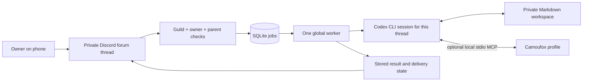

# Architecture

Authorization occurs before enqueue. The adapter verifies the bot identity, configured guild
owner, private forum and reply thread parent. Queue identity is the Discord message ID;
re-delivery of the same ID does not create new work.

A claim is an atomic SQLite update. A global running-job guard serializes all threads and
protects the optional shared browser profile. Startup recovery requires an external singleton
lock: a second engine must not mark a live first engine's work as interrupted.

The worker checks Codex login before claiming work. The subprocess gets the selected private
workspace, explicit writable artifact/browser directories and an environment allowlist. It uses
no shell to execute prompts. The parser bounds event bytes and output, pins resumed session
identity, and requires a completed turn. Cancellation and timeout stop the process group.

## State versus effects

A task transitions from queued to running, then succeeded, failed or interrupted. Non-success
blocks further work in that conversation until deliberate recovery. Restarted running work is
interrupted, not queued. Recovery creates a new job with a reference to the original request.
Terminal state and conversation blocking commit in one transaction; a failed write preserves
the running state for reconciliation. Session reset and queued cancellation are also atomic.
Recovery refuses overlap with queued recovery or running work in that thread and refuses to
replay an ancestor already recovered successfully. A failed recovery can itself be recovered.

Notification delivery separately records pending, sending, sent or ambiguous. A process crash
after reserving delivery cannot safely establish whether Discord accepted it. The reservation
becomes ambiguous on startup; the engine does not automatically resend it. `!result` retrieves
the saved answer without rerunning the task.

These are local guarantees. They do not form a transaction with an external website.

`!status` reports the current thread's queue, block reason, session presence, and delivery
state. Global worker occupancy is only a boolean: another thread's identifiers, prompts,
results, and session IDs are not included. `!help` and invalid controls never enqueue work.

## Private memory

The engine reads bounded instruction/context files and renders each thread's transcript from
SQLite. Local automatic Git commits include only selected regular Markdown paths under
`agent/`; staged unrelated changes block the automatic commit. Git hooks are disabled for
these operations. No remote credential or push implementation is included.

## Deliberate limits

One worker; one configured server owner; text-only intake; no REST history catch-up; no
scheduler; no built-in public posting destination or receipt broker. Extending these requires
explicit authority checks, durable state and regression tests at the new boundary.
